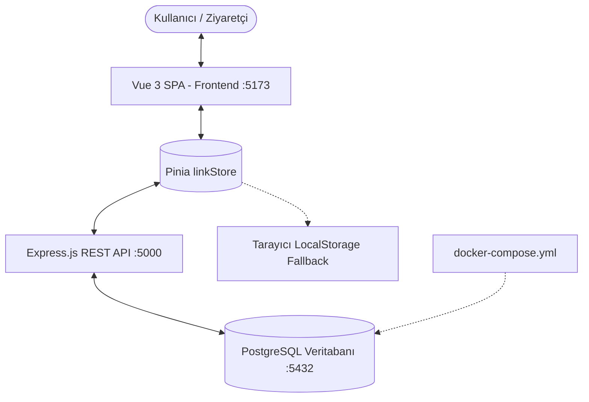

# 🏗️ 01 - MİMARİ VE TEKNOLOJİ YIĞINI (ARCHITECTURE)

## 1. Genel Mimari Bakış
Bu proje, modern bir **Full-Stack SPA & REST API** mimarisine sahiptir.
- **Frontend**: Vue 3'ün `Composition API` ve `<script setup>` paradigması temel alınmıştır. Durum yönetimi için `Pinia`, sayfa geçişleri için `Vue Router`, tasarım için utility-first `Tailwind CSS`, ikonlar için `Lucide Icons`.
- **Backend**: Node.js & Express.js REST API servisi.
- **Veritabanı**: PostgreSQL (İlişkisel Veritabanı) & Hibrit Tarayıcı Kalıcılığı (`localStorage` fallback).



---

## 2. Teknoloji Yığını (Tech Stack)

### Frontend
| Teknoloji | Versiyon | Görev / Kullanım Amacı |
|:---|:---|:---|
| **Vue.js** | `^3.5.42` | Reaktif bileşen mimarisi (`<script setup>`, Composition API) |
| **Vite** | `^8.3.0` | Derleme ve geliştirme sunucusu |
| **Vue Router** | `^5.4.0` | SPA Rota yönetimi (`/` ve `/admin`) |
| **Pinia** | `^4.1.0` | Merkezi reaktif durum yönetimi (Global State Store) |
| **Tailwind CSS** | `^3.4.1` | Utility-first CSS tasarım ve 5 dinamik tema sistemi |
| **Lucide Vue Next** | `^1.0.0` | Vektörel arayüz ikonları |

### Backend & Veritabanı
| Teknoloji | Versiyon | Görev / Kullanım Amacı |
|:---|:---|:---|
| **Node.js** | `v24.x` | JavaScript çalışma zamanı ortamı |
| **Express.js** | `^4.19.2` | RESTful API sunucu çatısı |
| **pg (node-postgres)**| `^8.11.5` | PostgreSQL bağlantı havuzu ve sorgu yürütücü |
| **dotenv & cors** | Son Sürüm | Çevre değişkenleri ve CORS güvenlik middleware'i |
| **PostgreSQL** | `16.x` | Kalıcı ilişkisel veritabanı (Profiles, Links, Settings) |
| **Docker** | `docker-compose`| PostgreSQL konteyneri yapılandırma dosyası |

---

## 3. Dizin ve Dosya Yapısı

```
linktree-projem/
├── .agents/                      # AI Agent kuralları ve özelleştirmeleri
│   └── rules/
│       └── vault-protocol.md     # Müdahale öncesi Vault kontrol kuralı
├── .vault/                       # Proje Bilgi Bankası (Single Source of Truth)
│   ├── 00_INDEX.md
│   ├── 01_ARCHITECTURE.md
│   ├── 02_CURRENT_STATE.md
│   ├── 03_DATA_MODELS.md
│   ├── 04_CODING_STANDARDS.md
│   ├── 05_ROADMAP_BACKLOG.md
│   ├── 06_INTERVENTION_PROTOCOL.md
│   └── 07_CHANGELOG.md
├── AGENTS.md                     # Kök düzeyinde AI / Geliştirici kuralları
├── docker-compose.yml            # PostgreSQL konteyner konfigürasyonu
├── backend/                      # Node.js + Express.js API Servisi
│   ├── src/
│   │   ├── db.js                 # PostgreSQL Pool ve bağlantı havuzu
│   │   ├── initDb.js             # Veritabanı tablo kurulumu ve tohumlama (Migration)
│   │   ├── routes/
│   │   │   ├── profileRoutes.js  # GET/PUT /api/profile
│   │   │   ├── linksRoutes.js    # CRUD, click & reorder /api/links
│   │   │   └── settingsRoutes.js # GET/PUT /api/settings/theme
│   │   └── server.js             # Express ana sunucu giriş noktası (:5000)
│   ├── .env                      # Veritabanı kimlik ve port bilgileri
│   ├── .env.example              # Örnek çevre değişkenleri şablonu
│   └── package.json              # Backend bağımlılıkları ve npm scriptleri
├── frontend/                     # Vue 3 İstemci Uygulaması
│   ├── src/
│   │   ├── router/               # Rota tanımları
│   │   ├── stores/
│   │   │   └── linkStore.js      # Pinia store (API Senkronizasyonu & Fallback)
│   │   ├── views/
│   │   │   ├── ProfileView.vue   # Ziyaretçi profil arayüzü (5 Tema destekli)
│   │   │   └── AdminView.vue     # Yönetim paneli (Link, Sıralama, Tema, Profil)
│   │   ├── App.vue
│   │   ├── main.js
│   │   └── style.css
│   ├── package.json
│   └── vite.config.js
```

---

## 4. REST API Uç Noktaları (Endpoints)

| Metot | Uç Nokta | Açıklama |
|:---|:---|:---|
| **GET** | `/api/health` | Sunucu sağlık kontrolü |
| **POST** | `/api/auth/register` | Yeni kullanıcı kaydı (email, benzersiz username, bcrypt hash) |
| **POST** | `/api/auth/login` | JWT kimlik doğrulama ve token üretimi |
| **GET** | `/api/auth/me` | Aktif kullanıcı oturum kontrolü |
| **POST** | `/api/auth/change-password` | Şifre güncelleme (JWT korumalı) |
| **GET** | `/api/profile` | Varsayılan genel profil bilgisi |
| **GET** | `/api/profile/:username` | Ziyaretçiler için profil ve yalnızca aktif (`is_active = true`) bağlantılar |
| **PUT** | `/api/profile` | Profil bilgilerini güncelle |
| **GET** | `/api/links` | Sıralı bağlantı listesini getir (`order_index ASC`) |
| **POST** | `/api/links` | Yeni bağlantı ekle (`title`, `url`, `order_index`, `is_active`) |
| **PUT** | `/api/links/:id` | Bağlantıyı güncelle (başlık, URL, aktiflik, stil) |
| **DELETE** | `/api/links/:id` | Bağlantıyı sil |
| **PUT / POST** | `/api/links/reorder` | Sıralama değiştiğinde toplu `order_index` güncellemesi |
| **POST** | `/api/links/:id/click` | Tıklanma sayısını 1 artıran sayaç (Atomik) |
| **POST** | `/api/links/reset-clicks` | Tıklama sayaçlarını sıfırla |
| **GET** | `/api/settings/theme` | Seçili profil temasını getir |
| **PUT** | `/api/settings/theme` | Profil temasını güncelle |
