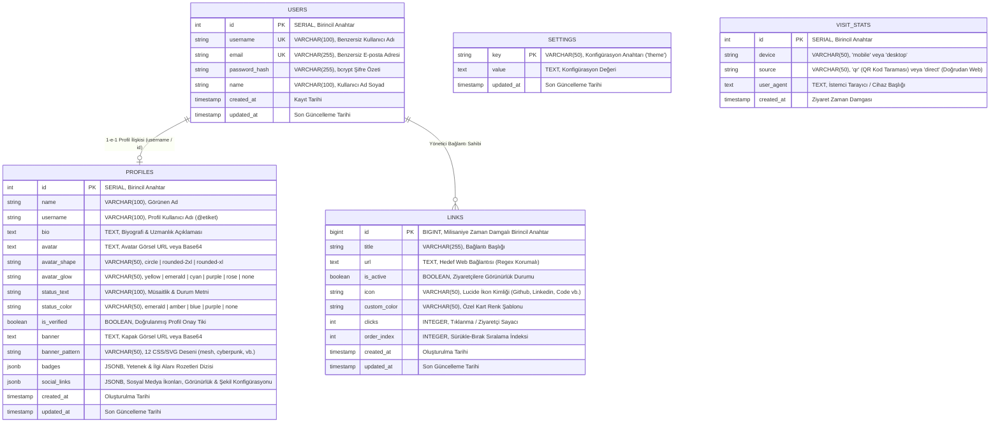

# 📊 Veritabanı Varlık-İlişki (Entity Relationship - ER) Şeması

Bu doküman, **Linkspace / Linktree Projesi**'nin PostgreSQL ilişkisel veritabanı mimarisini, tablo yapılarını, sütun kısıtlarını (constraints), indeksleri ve varlık ilişkilerini staj raporu ve mentor sunumuna hazır formatta sunmaktadır.

---

## 1. Mermaid Görsel ER Diyagramı

---

## 2. Detaylı Tablo Sözlüğü (Data Dictionary)

### A. `users` Tablosu
Sistemdeki yöneticilerin ve kullanıcıların kimlik doğrulama bilgilerini barındırır.
| Sütun Adı | Veri Tipi | Kısıtlar (Constraints) | Açıklama |
|---|---|---|---|
| `id` | `SERIAL` | `PRIMARY KEY` | Benzersiz otomatik artan kullanıcı kimliği |
| `username` | `VARCHAR(100)` | `UNIQUE`, `NOT NULL` | Giriş için kullanılan tekil kullanıcı adı |
| `email` | `VARCHAR(255)` | `UNIQUE` | Kullanıcı e-posta adresi |
| `password_hash` | `VARCHAR(255)` | `NOT NULL` | bcrypt ile tuzlanarak (salt=10) özetlenmiş parola |
| `name` | `VARCHAR(100)` | `NOT NULL` | Kullanıcının tam adı |
| `created_at` | `TIMESTAMP WITH TIME ZONE` | `DEFAULT CURRENT_TIMESTAMP` | Hesabın oluşturulma zamanı |
| `updated_at` | `TIMESTAMP WITH TIME ZONE` | `DEFAULT CURRENT_TIMESTAMP` | Hesabın son güncelleme zamanı |

### B. `profiles` Tablosu
Kullanıcının Linktree vitrinindeki zenginleştirilmiş profil kimlik ve görsel tasarım tercihlerini saklar.
| Sütun Adı | Veri Tipi | Varsayılan | Açıklama |
|---|---|---|---|
| `id` | `SERIAL` | `PRIMARY KEY` | Profil birincil anahtarı |
| `name` | `VARCHAR(100)` | `NOT NULL` | Profilde görünen başlık |
| `username` | `VARCHAR(100)` | `NOT NULL` | URL yönlendirmesinde kullanılan `@kullaniciadi` |
| `bio` | `TEXT` | `NULL` | Kısa biyografi metni |
| `avatar` | `TEXT` | `NULL` | Avatar görseli URL'i veya Base64 verisi |
| `avatar_shape` | `VARCHAR(50)` | `'circle'` | Avatar çerçevesi: `circle`, `rounded-2xl`, `rounded-xl` |
| `avatar_glow` | `VARCHAR(50)` | `'yellow'` | Parıltı aurası: `yellow`, `emerald`, `cyan`, `purple`, `rose`, `none` |
| `status_text` | `VARCHAR(100)` | `'Yeni Projelere...'` | Profil başlığının üstündeki durum/müsaitlik bildirimi |
| `status_color` | `VARCHAR(50)` | `'emerald'` | Durum rozetinin sinyal rengi |
| `is_verified` | `BOOLEAN` | `TRUE` | Doğrulanmış profil rozeti (Sarı onay tiki) açık/kapalı |
| `banner` | `TEXT` | `''` | Özel yüklenen kapak görseli (URL veya Base64) |
| `banner_pattern` | `VARCHAR(50)` | `'mesh'` | 12 hazır CSS/SVG kapak deseninden seçilen şablon kimliği |
| `badges` | `JSONB` | `'[]'::jsonb` | Uzmanlık ve beceri rozetleri listesi (`[{id, text, icon, color}]`) |
| `social_links` | `JSONB` | `'{}'::jsonb` | Sosyal platform bağlantıları, tekil görünürlük flag'leri, bar geometrisi ve stili |
| `created_at` | `TIMESTAMP WITH TIME ZONE` | `CURRENT_TIMESTAMP` | Profil oluşturulma tarihi |
| `updated_at` | `TIMESTAMP WITH TIME ZONE` | `CURRENT_TIMESTAMP` | Profil son güncelleme tarihi |

### C. `links` Tablosu
Kullanıcının eklediği yönlendirme bağlantılarını, sürükle-bırak sırasını ve tıklama sayaçlarını saklar.
| Sütun Adı | Veri Tipi | Kısıtlar | Açıklama |
|---|---|---|---|
| `id` | `BIGINT` | `PRIMARY KEY` | Zaman damgalı tekil bağlantı kimliği |
| `title` | `VARCHAR(255)` | `NOT NULL` | Bağlantının butonda görünen başlığı |
| `url` | `TEXT` | `NOT NULL` | Hedef URL (Backend & Frontend Regex doğrulamalı) |
| `is_active` | `BOOLEAN` | `DEFAULT TRUE` | Bağlantının ziyaretçilere açık/kapalı olma durumu |
| `icon` | `VARCHAR(50)` | `NULL` | Lucide ikon adı veya `'auto'` |
| `custom_color` | `VARCHAR(50)` | `'default'` | Özel buton renk stili (amber, violet, emerald, sky vb.) |
| `clicks` | `INTEGER` | `DEFAULT 0` | Bağlantının toplam tıklanma sayacı |
| `order_index` | `INTEGER` | `DEFAULT 0` | Dikey sıralama ağırlığı |
| `created_at` | `TIMESTAMP WITH TIME ZONE` | `CURRENT_TIMESTAMP` | Eklenme zamanı |
| `updated_at` | `TIMESTAMP WITH TIME ZONE` | `CURRENT_TIMESTAMP` | Güncellenme zamanı |

### D. `visit_stats` Tablosu
QR kod okutmaları ve doğrudan web girişlerinin cihaz ve kaynak analitiğini saklar.
| Sütun Adı | Veri Tipi | Varsayılan | Açıklama |
|---|---|---|---|
| `id` | `SERIAL` | `PRIMARY KEY` | Otomatik artan ziyaret kimliği |
| `device` | `VARCHAR(50)` | `'desktop'` | Ziyaretçi cihaz tipi: `'mobile'` veya `'desktop'` |
| `source` | `VARCHAR(50)` | `'direct'` | Ziyaret kanalı: `'qr'` veya `'direct'` |
| `user_agent` | `TEXT` | `NULL` | İstemci cihaz User-Agent başlığı |
| `created_at` | `TIMESTAMP WITH TIME ZONE` | `CURRENT_TIMESTAMP` | Ziyaret zaman damgası |

### E. `settings` Tablosu
Uygulama genelindeki sistem ayarlarını ve varsayılan ziyaretçi temasını saklar.
| Sütun Adı | Veri Tipi | Kısıtlar | Açıklama |
|---|---|---|---|
| `key` | `VARCHAR(50)` | `PRIMARY KEY` | Ayar anahtarı (örn: `'theme'`) |
| `value` | `TEXT` | `NOT NULL` | Ayar değeri (örn: `'pure-dark'`, `'pure-light'`) |
| `updated_at` | `TIMESTAMP WITH TIME ZONE` | `CURRENT_TIMESTAMP` | Son güncelleme zamanı |

---

## 3. Güvenlik, Performans ve İndeksleme
1. **Dizinler (Indexes)**:
   - `users.username` ve `users.email` üzerinde benzersiz (`UNIQUE B-Tree`) indeksler aktiftir.
   - `profiles.username` üzerinde hızlı arama ve `/:username` rotası için `LOWER(username)` fonksiyonel araması optimize edilmiştir.
   - `links.order_index` ve `links.is_active` filtreleri ile ziyaretçi sorguları minimal gecikmeyle yanıtlanır.
2. **Kaskad ve Bütünlük**:
   - `profiles` tablosundaki `badges` ve `social_links` alanları `JSONB` türünde tutularak şema göçü (migration) gerekmeksizin yeni özelliklerin esnekçe eklenmesi sağlanmıştır.
